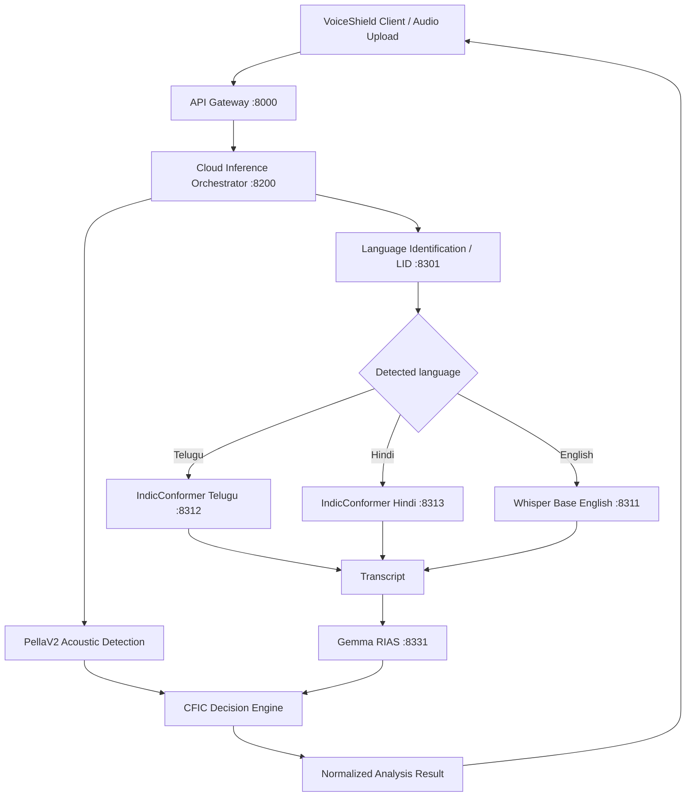

# CloudForge Intelligence Core (CFIC) × VoiceShield

**Team: Prompt Pirates**  
**Organization:** SAI Labs  
**Event:** HackWithAditya 2026  
**Repository Lead & System Architect:** Kasukurthi Yuvatejasainadh Sainadh  
**Deployment:** Docker Compose  
**Architecture:** Decoupled hybrid microservices

> CFIC is the backend intelligence layer for VoiceShield, a voice-security system that combines acoustic deepfake detection with transcript-based conversational fraud analysis.

---

## Overview

CloudForge Intelligence Core (CFIC) powers **VoiceShield** by coordinating independent machine-learning services and combining their evidence into an explainable risk outcome.

VoiceShield analyzes submitted audio through two complementary paths:

- **Acoustic intelligence:** PellaV2 evaluates audio for synthetic or manipulated speech.
- **Conversational intelligence:** language identification (LID) selects the ASR model; the transcript is then evaluated by Gemma RIAS for fraud, impersonation, and social-engineering risk.

The API Gateway handles client requests, authentication, validation, request tracing, and final response orchestration. The Cloud Inference Orchestrator coordinates model services over Docker's internal network.

## Goals

- Identify potential AI-generated or manipulated speech.
- Identify the spoken language and transcribe supported languages.
- Detect conversational fraud patterns, impersonation, urgency, intimidation, and manipulation.
- Combine acoustic and conversational evidence without conflating their signals.
- Provide fail-safe results when required evidence is unavailable.
- Keep model-serving components modular and independently deployable.

## Architecture

### High-level request flow



### Components

| Component | Responsibility | Port |
|---|---|---:|
| API Gateway | Public API, authentication, rate limits, upload validation, request IDs, orchestration and final decision | 8000 |
| Cloud Inference Orchestrator | Coordinates model calls, language routing, response normalization and inference status | 8200 |
| LID | Detects language and supplies routing signal | 8301 |
| English ASR | Whisper Base English transcription | 8311 |
| Telugu ASR | IndicConformer Telugu transcription | 8312 |
| Hindi ASR | IndicConformer Hindi transcription | 8313 |
| PellaV2 | Acoustic synthetic/manipulated-speech detection | 8321 |
| Gemma RIAS | Transcript-based conversational risk assessment | 8331 |

> Ports shown are the intended service ports. Confirm actual exposed ports and service health with the current Compose configuration.

### Two evidence paths

**Path A — Acoustic detection**
- Input: audio
- Service: PellaV2
- Output: acoustic detection result and model metadata

**Path B — Conversational analysis**
1. LID identifies the language.
2. Orchestrator routes to the appropriate ASR service.
3. ASR returns a transcript.
4. Gemma RIAS evaluates transcript content for conversational risk.

The CFIC Decision Engine combines the available evidence and service statuses. It must not treat a failed or missing inference as a safe result.

## Model stack

| Capability | Selected model/service | Notes |
|---|---|---|
| Language identification | Open-Vakgyata | Language routing |
| English transcription | Whisper Base English | English ASR service |
| Telugu transcription | IndicConformer Telugu | Telugu-specific checkpoint |
| Hindi transcription | IndicConformer Hindi | Hindi-specific checkpoint |
| Acoustic deepfake detection | PellaV2 | Acoustic evidence |
| Conversational risk assessment | Gemma 4 E2B IT | GGUF Q4_K_M, served through llama.cpp |

Model weights are distributed separately from application source and mounted into their services where configured. Checkpoint versions, licenses, checksums, and runtime settings should be recorded in model documentation.

### Explicit architecture decisions

- **PellaV2 is the selected acoustic detector.**
- **Gemma RIAS is the conversational risk model.**
- **Qwen is not part of the selected runtime architecture.**
- **VMC-South and the AASIST-L fallback are legacy/out-of-scope for the current architecture.** Remove obsolete references from active Compose wiring and documentation only through the project's reviewed integration work; their presence in an older checkout does not mean they are part of the target design.

## Decision outcomes

The CFIC Decision Engine returns one of the following:

| Outcome | Meaning |
|---|---|
| `GENUINE` | Evidence supports a genuine/non-suspicious classification under the decision policy |
| `FAKE` | Acoustic evidence indicates synthetic or manipulated speech |
| `SUSPICIOUS` | Conversational evidence or a high-risk signal indicates potential fraud |
| `INCONCLUSIVE` | Required evidence is missing, invalid, conflicting, or insufficient |

The decision policy is deterministic and fail-safe. High-risk evidence must not be silently downgraded by a low-risk signal, and missing inference results must never be interpreted as proof of safety.

## Repository layout

```text
.
├── api-gateway/                 # Client API, auth, validation, response orchestration
├── cloud-inference/
│   ├── orchestrator/            # Internal model coordination and routing
│   ├── models/
│   │   ├── lid/                 # Language identification
│   │   ├── asr/
│   │   │   └── indicconformer/
│   │   │       ├── english/     # Whisper English service
│   │   │       ├── hindi/       # Hindi IndicConformer
│   │   │       └── telugu/      # Telugu IndicConformer
│   │   ├── pellav2/            # PellaV2 acoustic detector
│   │   └── rias/                # Gemma RIAS
│   ├── shared/                  # Shared contracts/utilities (where present)
│   └── llm-evaluation/          # RIAS evaluation assets (where present)
├── docs/                         # Architecture, API, deployment, model docs
├── scripts/                       # Helper scripts
├── docker-compose.yml
└── README.md
```

This is the logical layout. Refer to the current repository tree for exact file locations and any additional test or infrastructure directories.

## API

### Local endpoint

- Base URL: `http://localhost:8000`
- Interactive API docs: `http://localhost:8000/docs`
- OpenAPI schema: `http://localhost:8000/openapi.json`

### Analyze audio

`POST /v1/analyze`

Send audio as multipart form data using the `file` field and include the configured API key in the `X-API-Key` header.

Supported upload formats documented by the endpoint: WAV, MP3, FLAC, and OGG.

Example with curl (replace the API key and path):

```bash
curl -X POST "http://localhost:8000/v1/analyze" \
  -H "X-API-Key: YOUR_API_KEY" \
  -F "file=@sample.wav"
```

Use Swagger UI at `/docs` for the authoritative request schema and response fields.

## Local deployment

### Prerequisites

- Docker Desktop with Docker Compose
- Git
- Sufficient memory and CPU for the model containers
- Model checkpoint files downloaded to the expected weight directories

### 1. Clone the repository

```bash
git clone https://github.com/yuvatejasainadh/cfic-for-voice-shield-hwa.git
cd cfic-for-voice-shield-hwa
```

### 2. Configure environment

Review `docker-compose.yml` and the service `.env.example` files. Set required values in a local `.env` file as appropriate.

Do not use real credentials in committed files. Never commit API keys, access tokens, or private model credentials.

For local testing, replace placeholder API keys with your own local value and use the same value when calling the API.

### 3. Prepare model weights

Download or obtain each model checkpoint according to the service-specific instructions. Place files in the configured weight directories. Do not commit large checkpoint files to the application repository.

Check each model's README for:
- exact checkpoint filename
- revision/commit
- license and use restrictions
- checksum
- expected runtime and memory

### 4. Build and start services

```bash
docker compose config
docker compose build
docker compose up -d
```

### 5. Verify services

```bash
docker compose ps
docker compose logs --tail=100 api-gateway cloud-inference-orchestrator
```

Check the Gateway health endpoint and open Swagger:

- `http://localhost:8000/docs`

The compose service names and health endpoints may differ across branches; use the current Compose file and service documentation.

### 6. Stop the stack

```bash
docker compose down
```

This stops and removes Compose containers and networks. Persistent named volumes are not removed unless you explicitly add `-v`; avoid doing so if you need to preserve cached/model data.

## Configuration and security

- Authentication uses the `X-API-Key` header.
- The Gateway enforces request limits configured by environment variables.
- The default upload size limit is 25 MiB.
- The documented rate-limit default is 30 requests per 60 seconds.
- The Gateway/orchestrator and model services should communicate over private Docker networking.
- Keep `.env` files local and out of version control.
- Avoid logging raw audio, sensitive transcripts, API keys, or credentials.
- Use request IDs to correlate service logs during debugging.
- Disable mock mode for real inference validation; check each service's environment configuration.

Configuration variable names and defaults can vary by service/version. Use `.env.example` and the actual service config as the source of truth.

## Testing and validation

Test each service independently before end-to-end integration.

Suggested validation sequence:

1. Gateway authentication, rate limiting, upload validation, and health checks.
2. LID language detection and confidence output.
3. ASR transcription for English, Hindi, and Telugu.
4. PellaV2 inference using genuine and synthetic/manipulated test samples.
5. Gemma RIAS structured risk assessment with transcript test cases.
6. Orchestrator routing, timeouts, error propagation, and response parsing.
7. Decision Engine tests for all supported evidence combinations.
8. End-to-end audio upload through `/v1/analyze`.
9. Verify behavior when a downstream model is unavailable or times out.

Use only appropriately licensed datasets and audio, and document the dataset split, evaluation method, and metrics when reporting model performance.

## Team — Prompt Pirates

**Team organization:** SAI Labs

| Contributor | Role | Ownership / focus |
|---|---|---|
| Kasukurthi Yuvateja Sainadh | Repository Lead & System Architect | Gateway, architecture, orchestration integration, decision engine, Compose, system testing and PR review |
| Pallavi | Telugu ASR Engineer | Telugu IndicConformer service packaging, API, container, accuracy and inference validation |
| Varshu | Hindi ASR Engineer | Hindi IndicConformer service packaging, API, container, accuracy and inference validation |
| Varun | MLOps & Model Optimization Engineer | PellaV2 quantization, model-size/latency comparison, quality validation, packaging and checksum |

Ownership describes team responsibilities and intended areas of contribution. Refer to the Git history and PRs for verified individual contribution records.

## Development workflow

1. Create a feature branch from the latest `main`.
2. Keep work scoped to the assigned component.
3. Run unit and service-level tests.
4. Validate Docker build and service health.
5. Update component documentation and configuration examples.
6. Open a PR against `main`.
7. Review shared API contracts and Docker changes before integration.
8. Merge only after CI and integration checks pass.

Do not commit model binaries, secrets, generated temporary audio, or local environment files unless explicitly approved.

## Known limitations / status discipline

This README describes the intended architecture and development workflow. It does not certify every model service, checkpoint, integration path, or performance target as operational.

- Model accuracy and latency must be backed by reproducible benchmarks.
- A container health check confirms service health, not necessarily successful inference.
- A downstream HTTP 200 is not sufficient evidence that the Gateway correctly consumed the model response.
- Inference timeouts and unavailable services must be reported accurately and must not result in a false `GENUINE` classification.
- Legacy services/configuration may still exist in older branches and should be treated as transitional until removed and validated.

## Roadmap

- Stabilize cloud orchestration and timeout/error propagation.
- Validate all model service contracts end-to-end.
- Improve Gemma RIAS inference latency and resource utilization.
- Expand language support and ASR evaluation.
- Add monitoring, metrics, and traceability.
- Improve deployment automation and reproducibility.

## Project identity

**CloudForge Intelligence Core (CFIC) × VoiceShield**  
**Team Prompt Pirates — SAI Labs**

Building intelligent voice security infrastructure to detect synthetic speech, impersonation, and conversational fraud.

**Prompt Pirates — Building Intelligence. Securing Voices.**
