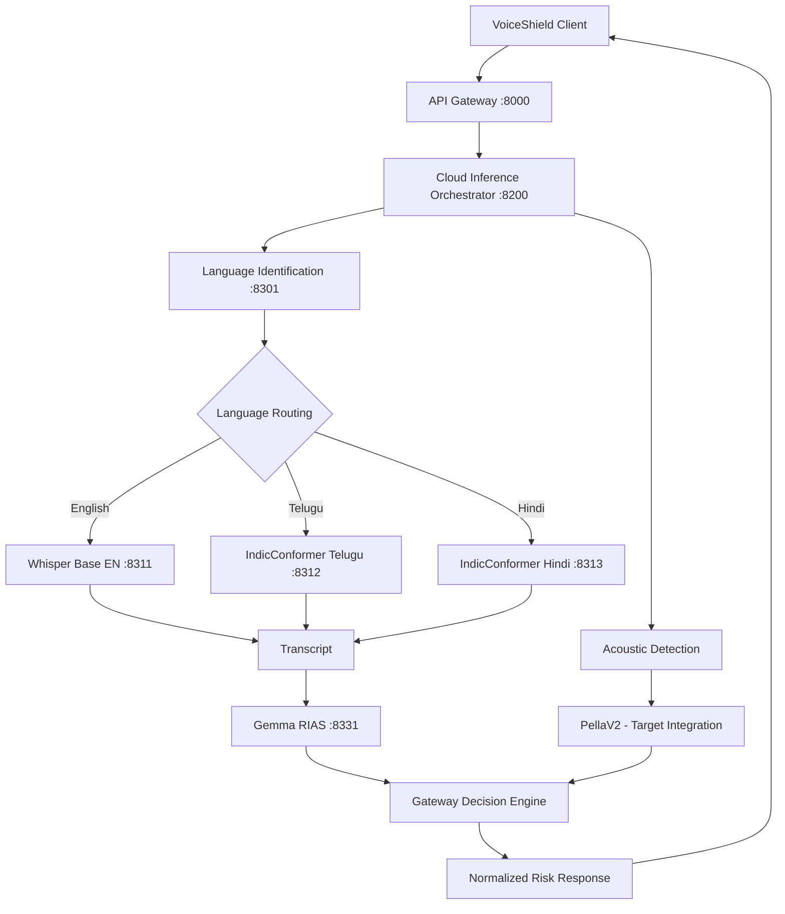

# CloudForge Intelligence Core (CFIC) × VoiceShield

<p align="center">
  <strong>Team Prompt Pirates</strong><br>
  SAI Labs · HackWithAditya 2026
</p>

> **Building Intelligence. Securing Voices.**

CloudForge Intelligence Core (CFIC) is the backend intelligence infrastructure powering **VoiceShield**, a voice-security platform designed to identify synthetic or manipulated speech and detect conversational fraud, impersonation, and social-engineering attacks.

CFIC uses a decoupled hybrid microservices architecture to coordinate audio intelligence, language identification, automatic speech recognition, and transcript-based risk assessment.

---

## 1. Project Overview

VoiceShield analyzes submitted audio through two complementary intelligence paths:

**Acoustic intelligence**
- Evaluates audio for synthetic or manipulated speech.
- Uses PellaV2 as the selected target acoustic detection model.
- Produces acoustic evidence independently of transcript-based analysis.

**Conversational intelligence**
- Identifies the spoken language.
- Routes audio to the appropriate ASR service.
- Produces a transcript.
- Evaluates conversational content for fraud, impersonation, urgency, intimidation, and social engineering through the RIAS assessment layer.

The API Gateway exposes the client-facing API, while the Cloud Inference Orchestrator coordinates independent model-serving services over private Docker networking.

### Project objectives

- Detect AI-generated and manipulated speech.
- Identify supported spoken languages.
- Transcribe English, Telugu, and Hindi audio.
- Identify conversational fraud and social-engineering indicators.
- Combine independent evidence streams into explainable risk outcomes.
- Preserve safe behavior when model services fail or return insufficient evidence.
- Support modular model deployment and independent service maintenance.

---

## 2. System Architecture

### High-level architecture



**Architecture status:** This diagram represents the target architecture. The uploaded repository's current Compose configuration still contains the legacy VMC-South and AASIST-L acoustic services. PellaV2 requires integration into the active inference pipeline before this diagram can be considered fully implemented.

### Architectural layers

| Layer | Component | Responsibility |
|---|---|---|
| Client layer | VoiceShield | Audio submission and result consumption |
| Public API | API Gateway | Authentication, validation, request handling and decision management |
| Orchestration | Cloud Inference Orchestrator | Model coordination, language routing and inference normalization |
| Language intelligence | Open-Vakgyata | Language identification |
| Speech intelligence | Whisper / IndicConformer | Speech transcription |
| Acoustic intelligence | PellaV2 | Target synthetic-speech detection |
| Conversational intelligence | Gemma RIAS | Transcript-based conversational risk assessment |
| Decision intelligence | CFIC Decision Engine / TCED | Final risk classification and safety enforcement |

### Service responsibilities

| Service | Compose service | Intended internal port |
|---|---|---:|
| API Gateway | `api-gateway` | 8000 |
| Cloud Inference Orchestrator | `cloud-inference-orchestrator` | 8200 |
| Language Identification | `model-lid` | 8301 |
| English ASR | `model-asr-en` | 8311 |
| Telugu ASR | `model-asr-te` | 8312 |
| Hindi ASR | `model-asr-hi` | 8313 |
| VMC-South (legacy wiring) | `model-vmc-south` | 8321 |
| AASIST-L fallback (legacy wiring) | `model-aasist-fallback` | 8322 |
| Gemma RIAS | `model-rias-gemma` | 8331 |

The internal port assignments must be checked against the current service configurations. Only the API Gateway publishes a host port in the supplied Compose configuration.

---

## 3. Hybrid Inference Pipeline

### Path A — Acoustic intelligence

The acoustic path evaluates audio independently of transcript content.

Target processing:

1. Receive the uploaded audio.
2. Perform the required audio preprocessing.
3. Execute PellaV2 inference.
4. Normalize the model output.
5. Return the acoustic prediction, score, and inference metadata.
6. Supply acoustic evidence to the CFIC decision layer.

**Selected acoustic detector:** PellaV2.

The repository currently includes PellaV2 quantization assets under `pellav2-quantized-final/`. These assets are not yet connected to the supplied Compose inference services.

### Path B — Conversational intelligence

The conversational path performs the following operations:

1. Open-Vakgyata identifies the language.
2. The orchestrator validates the language identification status and confidence.
3. The language router selects the corresponding ASR backend.
4. ASR generates the transcript.
5. Gemma RIAS evaluates the transcript.
6. The result is normalized and passed to the decision layer.

### Language routing

| Language | Language code | ASR service | Model |
|---|---|---|---|
| English | `en` | `model-asr-en` | Whisper Base English |
| Telugu | `te` | `model-asr-te` | IndicConformer Telugu |
| Hindi | `hi` | `model-asr-hi` | IndicConformer Hindi |

Unsupported languages must be reported explicitly rather than silently routed to an unrelated ASR model.

When language identification is inconclusive, the orchestrator must not continue as though a valid transcript were available.

### RIAS — Risk Intelligence Assessment System

Gemma RIAS evaluates the generated transcript for suspicious conversational patterns, including:

- Financial manipulation and payment requests.
- Identity impersonation.
- Threats and intimidation.
- Artificial urgency and pressure.
- Social-engineering tactics.
- Suspicious instructions and deceptive intent.

The selected local model configuration in the supplied Compose file is:

| Parameter | Configuration |
|---|---|
| Model | Gemma 4 E2B IT |
| Quantization | GGUF Q4_K_M |
| Runtime | llama.cpp-based service |
| Context size | 2048 |
| Maximum generated tokens | 16 |
| Threads | 4 |
| Maximum concurrent requests | 2 |
| Request timeout | 30 seconds |

The current Compose configuration points to:

`/app/weights/gemma-4-E2B-it-Q4_K_M.gguf`

The model checkpoint must be supplied in the configured weights directory.

---

## 4. CFIC Decision Engine

The CFIC Decision Engine combines available acoustic and conversational evidence into a normalized outcome.

### Supported outcomes

| Outcome | Description |
|---|---|
| `GENUINE` | Available evidence supports a non-suspicious classification |
| `FAKE` | Acoustic evidence identifies potentially synthetic or manipulated speech |
| `SUSPICIOUS` | Conversational evidence identifies a high-risk or potentially fraudulent interaction |
| `INCONCLUSIVE` | Evidence is missing, invalid, conflicting, or insufficient |

### Safety rules

The decision layer must preserve the following behavior:

1. A high-risk RIAS result must trigger `SUSPICIOUS`, regardless of an acoustic result indicating genuine audio.
2. Missing or failed model inference must never be treated as proof that audio is genuine.
3. Invalid risk levels must not silently default to low risk.
4. Unsupported languages and unsuccessful transcription must be represented explicitly.
5. Model timeouts and downstream errors must be propagated accurately.
6. The system must preserve the distinction between acoustic authenticity and conversational intent.

The Gateway implementation contains the decision-engine and TCED modules. The exact runtime behavior must be validated against the current tests and actual inference responses.

---

## 5. Model Stack

| Capability | Selected model | Purpose |
|---|---|---|
| Language identification | Open-Vakgyata | Spoken-language identification |
| English ASR | Whisper Base English | English transcription |
| Telugu ASR | IndicConformer Telugu | Telugu transcription |
| Hindi ASR | IndicConformer Hindi | Hindi transcription |
| Acoustic detection | PellaV2 | Synthetic and manipulated speech detection |
| Conversational assessment | Gemma 4 E2B IT | Transcript-based fraud risk assessment |

### Model selection decisions

- PellaV2 is the selected acoustic detector.
- Gemma RIAS is the selected conversational assessment model.
- Qwen is excluded from the selected runtime architecture.
- VMC-South and AASIST-L are legacy components that are not part of the target architecture.
- Model weights are maintained separately from application source wherever possible.

### Model artifact management

Before deploying a model checkpoint, document:

- Model name and revision.
- Source and licensing information.
- Checkpoint filename.
- SHA-256 checksum.
- Quantization format.
- Runtime requirements.
- Memory footprint.
- Benchmark results.

Model artifacts should not be committed to the application repository unless explicitly approved.

### PellaV2 quantization assets

The uploaded repository contains:

```text
pellav2-quantized-final/
├── 293mb/
│   └── .gitkeep
├── benchmark/
│   ├── benchmark_results.json
│   └── comparison.md
├── config/
│   ├── k12_calibration.json
│   └── quantization_293mb.json
├── tokenizer/
│   └── README.md
├── checksums.txt
├── model_card.md
└── README.md
```

This directory contains quantization documentation and benchmark artifacts. The model binaries are not included in the supplied ZIP. Confirm the final checkpoint, model polarity, and deployment contract before integrating PellaV2 into the running pipeline.

---

## 6. Repository Structure

The following is the repository structure observed in the uploaded project archive, summarized by functional area.

```text
CFIC-VoiceShield-HackVersion/
│
├── api-gateway/
│   ├── app/
│   │   ├── api/
│   │   │   └── routes/
│   │   ├── core/
│   │   │   ├── config.py
│   │   │   ├── errors.py
│   │   │   ├── rate_limiter.py
│   │   │   └── security.py
│   │   ├── middleware/
│   │   ├── orchestration/
│   │   │   ├── analysis_orchestrator.py
│   │   │   └── decision_engine.py
│   │   ├── schemas/
│   │   ├── services/
│   │   └── tced/
│   ├── services/
│   │   ├── pella/
│   │   ├── rias/
│   │   └── transcription/
│   ├── tests/
│   │   ├── contracts/
│   │   ├── integration/
│   │   └── unit/
│   ├── Dockerfile
│   ├── requirements.txt
│   └── .env.example
│
├── cloud-inference/
│   ├── orchestrator/
│   │   ├── app/
│   │   │   ├── api/
│   │   │   ├── core/
│   │   │   ├── routing/
│   │   │   ├── schemas/
│   │   │   └── services/
│   │   ├── tests/
│   │   └── Dockerfile
│   │
│   ├── models/
│   │   ├── lid/
│   │   │   ├── app/
│   │   │   ├── tests/
│   │   │   └── weights/
│   │   ├── asr/
│   │   │   └── indicconformer/
│   │   │       ├── english/
│   │   │       ├── hindi/
│   │   │       └── telugu/
│   │   ├── rias/
│   │   │   ├── app/
│   │   │   ├── scripts/
│   │   │   ├── tests/
│   │   │   └── weights/
│   │   ├── vmc-south/
│   │   └── aasist-fallback/
│   │
│   ├── shared/
│   │   ├── audio/
│   │   ├── contracts/
│   │   └── schemas/
│   │
│   └── llm-evaluation/
│       ├── config/
│       ├── datasets/
│       ├── prompts/
│       ├── results/
│       ├── scripts/
│       └── tests/
│
├── docs/
│   ├── api-contracts/
│   ├── architecture/
│   ├── deployment/
│   └── security/
│
├── infrastructure/
│   ├── monitoring/
│   ├── postgres/
│   └── redis/
│
├── legacy/
│   └── services/
│
├── pellav2-quantized-final/
│   ├── benchmark/
│   ├── config/
│   ├── tokenizer/
│   └── model_card.md
│
├── scripts/
│   ├── e2e_validation.py
│   ├── run_local.sh
│   ├── run_local.bat
│   ├── run_tests.sh
│   └── run_tests.bat
│
├── docker-compose.yml
├── pyproject.toml
├── requirements-dev.txt
├── BRANCHES.txt
└── README.md
```

---

## 7. API Reference

### API Gateway

**Base URL**

```text
http://localhost:8000
```

**Interactive API documentation**

```text
http://localhost:8000/docs
```

**OpenAPI schema**

```text
http://localhost:8000/openapi.json
```

### Analyze audio

```http
POST /v1/analyze
```

Request format: `multipart/form-data`

| Parameter | Type | Description |
|---|---|---|
| `file` | File | Audio recording to analyze |
| `X-API-Key` | Header | Configured API authentication key |
| `X-Request-ID` | Optional header | Request correlation identifier |

The Gateway route documents WAV, MP3, FLAC, and OGG audio uploads.

### Example request

```bash
curl -X POST "http://localhost:8000/v1/analyze" \
  -H "X-API-Key: YOUR_API_KEY" \
  -F "file=@sample.wav"
```

### Health endpoints

The Gateway exposes health routes through its API routing modules. The orchestrator exposes:

```http
GET /health
```

Use the running application's `/docs` endpoint and route definitions as the authoritative source for exact endpoint behavior.

### Internal inference endpoint

The current orchestrator exposes:

```http
POST /v1/inference
```

It accepts multipart audio and optional tracking metadata:

| Parameter | Description |
|---|---|
| `file` | Audio chunk |
| `session_id` | Optional session identifier |
| `chunk_index` | Sequential chunk number |
| `timestamp_start_s` | Chunk start position |
| `timestamp_end_s` | Chunk end position |

This endpoint is internal and is not intended to be exposed as a public client API.

---

## 8. Docker Deployment

CFIC uses Docker Compose to run the Gateway, orchestrator, and independent model-serving containers.

### Prerequisites

- Docker Desktop or Docker Engine.
- Docker Compose V2.
- Git.
- Python 3.10 or later for local development and test tooling.
- Sufficient CPU and RAM for the selected model workloads.
- Required model checkpoints and their licenses.
- Network access for obtaining model artifacts when required.

### 1. Clone the repository

```bash
git clone https://github.com/yuvatejasainadh/cfic-for-voice-shield-hwa.git

cd cfic-for-voice-shield-hwa
```

### 2. Configure environment

The repository contains an API Gateway environment template:

```text
api-gateway/.env.example
```

Create and configure the local environment:

```bash
cp api-gateway/.env.example api-gateway/.env
```

On Windows PowerShell:

```powershell
Copy-Item api-gateway/.env.example api-gateway/.env
```

Set an appropriate local API key and any required credentials.

Never commit real API keys, tokens, passwords, or private credentials.

**Note:** The supplied Compose file also uses root-level variable substitutions. Review `docker-compose.yml` and the individual service settings to ensure the variables are available in the Compose environment. A service-specific `.env` file is not automatically a root Compose environment file.

### 3. Prepare model weights

The model services use weight directories mounted into their containers.

Important directories include:

```text
cloud-inference/models/lid/weights/
cloud-inference/models/asr/indicconformer/english/weights/
cloud-inference/models/asr/indicconformer/telugu/weights/
cloud-inference/models/asr/indicconformer/hindi/weights/
cloud-inference/models/rias/weights/
```

Use the corresponding service documentation for model filenames and checkpoint requirements.

The Gemma RIAS service expects:

```text
gemma-4-E2B-it-Q4_K_M.gguf
```

at the configured model path.

The PellaV2 checkpoint must be separately obtained and integrated into an appropriate service before live PellaV2 inference is available through Compose.

### 4. Validate Compose configuration

```bash
docker compose config
```

Resolve any missing environment variables, invalid Dockerfile paths, and service configuration errors before building.

### 5. Build the containers

```bash
docker compose build
```

### 6. Start the services

```bash
docker compose up -d
```

### 7. Verify container status

```bash
docker compose ps
```

Inspect the Gateway and orchestrator logs:

```bash
docker compose logs --tail=100 api-gateway
docker compose logs --tail=100 cloud-inference-orchestrator
```

Inspect individual model logs:

```bash
docker compose logs --tail=100 model-lid
docker compose logs --tail=100 model-asr-en
docker compose logs --tail=100 model-asr-te
docker compose logs --tail=100 model-asr-hi
docker compose logs --tail=100 model-rias-gemma
```

### 8. Access the API

```text
http://localhost:8000/docs
```

### 9. Stop the application

```bash
docker compose down
```

This removes the running containers and networks but preserves named volumes unless explicitly instructed otherwise.

Avoid using `docker compose down -v` when preserving cached model files is important.

---

## 9. Configuration and Security

### API protection

The API Gateway provides:

- API-key authentication through `X-API-Key`.
- In-memory sliding-window rate limiting.
- Maximum upload size validation.
- Empty payload rejection.
- Request ID propagation.
- Structured error handling.

### Documented defaults

| Setting | Default |
|---|---:|
| API request limit | 30 requests |
| Rate-limit window | 60 seconds |
| Maximum audio size | 25 MiB |
| Gateway downstream timeout | 30 seconds |

Actual values are controlled by the application configuration and the Compose environment. Confirm effective runtime settings before deployment.

### Network security

The Compose configuration defines:

- `cfic-public-network`
- `cfic-internal-network`

Only the API Gateway publishes port `8000` to the host in the supplied configuration.

The orchestrator and model services communicate using Docker service DNS names over the internal network.

### Security practices

- Keep credentials in local environment files or a secrets manager.
- Never log authentication tokens or private API keys.
- Avoid storing raw uploaded audio unnecessarily.
- Protect sensitive transcripts and risk-assessment results.
- Restrict model endpoints to internal service communication.
- Use request IDs for debugging and distributed tracing.
- Use appropriately licensed and consented audio data for evaluation.

---

## 10. Testing and Validation

The repository contains unit, integration, and contract tests across the Gateway, orchestrator, LID, ASR, and RIAS areas.

### Install development dependencies

```bash
pip install -r requirements-dev.txt
```

### Run all tests

From the appropriate project/test environment:

```bash
python -m pytest -v
```

### Gateway tests

```bash
cd api-gateway

python -m pytest tests/unit -v
python -m pytest tests/contracts -v
python -m pytest tests/integration -v
```

### Orchestrator tests

```bash
cd cloud-inference/orchestrator

python -m pytest tests -v
```

### LID tests

```bash
cd cloud-inference/models/lid

python -m pytest tests -v
```

### RIAS tests

```bash
cd cloud-inference/models/rias

python -m pytest tests -v
```

### End-to-end validation

The repository includes:

```text
scripts/e2e_validation.py
scripts/e2e_results.json
```

Use the supplied validation scripts and review their results before reporting integration success.

### Recommended validation checklist

- [ ] Gateway authentication works.
- [ ] Upload size and format validation work.
- [ ] Request IDs are propagated correctly.
- [ ] LID returns an expected language and confidence.
- [ ] English ASR returns usable transcription.
- [ ] Telugu ASR returns usable transcription.
- [ ] Hindi ASR returns usable transcription.
- [ ] RIAS returns valid structured risk results.
- [ ] Acoustic detection returns validated predictions.
- [ ] Orchestrator routes requests correctly.
- [ ] Gateway correctly consumes downstream responses.
- [ ] TCED enforces the high-risk override.
- [ ] Missing evidence produces safe outcomes.
- [ ] Downstream timeout and service failure behavior is correct.
- [ ] Full audio upload works through `/v1/analyze`.

A passing container health check is not proof of successful model inference. Mock inference must not be presented as real model accuracy or real deepfake detection performance.

---

## 11. Model Evaluation

The repository contains evaluation resources for RIAS under:

```text
cloud-inference/llm-evaluation/
```

These include:

- Evaluation configuration.
- Risk-assessment rubric.
- Dataset manifest.
- Development, validation, and test datasets.
- Prompt definitions.
- Model evaluation scripts.
- Comparison results.
- Robustness tests.

Model evaluations should report:

| Metric | Purpose |
|---|---|
| Accuracy | Overall classification correctness |
| Precision | Reliability of positive risk predictions |
| Recall | Ability to identify relevant risk cases |
| F1-score | Balance of precision and recall |
| WER | Speech transcription quality |
| Latency | Inference response time |
| Model size | Deployment footprint |
| Memory | Runtime resource consumption |

For PellaV2, record the test dataset, checkpoint, quantization type, score polarity, threshold, EER, and latency.

For ASR, evaluate each language independently using suitable language-specific datasets.

For RIAS, use a fixed evaluation dataset and consistent risk labels across model comparisons.

Do not report benchmark results without the corresponding evaluation method and test conditions.

---

## 12. Team — Prompt Pirates

**Organization:** SAI Labs  
**Event:** HackWithAditya 2026

| Contributor | Designation | Primary Responsibilities |
|---|---|---|
| **Yuvateja Sainadh** | Applied AI Engineer, Systems Architect & Cloud Infrastructure Architect | Overall system architecture, applied AI integration, API Gateway, inference orchestration, decision engine, Docker infrastructure, service integration, system validation and technical coordination |
| **Pallavi** | Cloud Engineer | Telugu ASR cloud service packaging, containerization, service deployment, API integration, infrastructure validation and speech inference testing |
| **Varshu** | Cloud Engineer | Hindi ASR cloud service packaging, containerization, service deployment, API integration, infrastructure validation and speech inference testing |
| **Varun** | MLOps Architect & ML Infrastructure Engineer | PellaV2 model optimization, quantization, artifact management, model packaging, benchmark analysis, inference infrastructure and reproducible deployment |
| **David** | ML Engineer | Machine-learning pipeline development, model integration, inference validation, evaluation experiments, model performance analysis and ML component development |

### Team ownership principles

- System architecture and component interfaces are coordinated centrally.
- Cloud Engineers own the deployment and integration of their assigned ASR services.
- The MLOps Architect owns model artifact readiness and optimized inference packaging.
- The ML Engineer contributes to model development, evaluation, and inference quality.
- Shared infrastructure and API contract changes are reviewed before integration.

These are team ownership areas, not a claim of verified individual Git contributions. Refer to repository history and pull requests for actual contribution records.

---

## 13. Development and Collaboration Workflow

All contributors should follow a controlled Git workflow.

1. Fetch the latest `main` branch.
2. Create a feature branch for the assigned component.
3. Keep changes scoped to the agreed task.
4. Follow the existing service contracts and directory structure.
5. Run component-level tests.
6. Validate the relevant Docker build.
7. Verify service health and real inference where applicable.
8. Update relevant documentation.
9. Open a pull request against `main`.
10. Complete code review and integration validation before merging.

### Git workflow example

```bash
git switch main
git pull origin main

git switch -c feature/component-name

# Implement changes and run tests

git add .
git commit -m "feat: describe component integration"

git push -u origin feature/component-name
```

Never commit:

- API keys and credentials.
- Local `.env` files.
- Large unapproved model binaries.
- Private audio recordings.
- Temporary benchmark outputs that are not intended for version control.

---

## 14. Current Repository Status and Integration Priorities

The uploaded repository should be understood as a development snapshot, not proof that every target component is already operational.

| Area | Repository evidence | Status |
|---|---|---|
| API Gateway | FastAPI implementation, API routes and tests | Implemented in source |
| Cloud Inference Orchestrator | Routing, service clients, schemas and tests | Implemented in source |
| Open-Vakgyata LID | Container, service code and weights directory | Present |
| English ASR | Whisper Base English service | Present |
| Telugu ASR | IndicConformer Telugu service | Present; mock mode defaults to true in Compose |
| Hindi ASR | IndicConformer Hindi service | Present; mock mode defaults to true in Compose |
| Gemma RIAS | Container, runtime configuration and evaluation assets | Present |
| PellaV2 | Quantization and benchmark documentation | Integration into active Compose pipeline pending |
| VMC-South | Legacy service and active Compose wiring | Present in snapshot; excluded from target architecture |
| AASIST-L | Legacy service and active Compose wiring | Present in snapshot; excluded from target architecture |
| Automated validation | Unit, integration, contract and E2E test assets | Present; execution results must be verified separately |

### Priority integration work

**1. Complete PellaV2 integration**

- Confirm the final quantized checkpoint.
- Validate score polarity and prediction thresholds.
- Add the PellaV2 model-serving service.
- Define its inference API contract.
- Wire it into the orchestrator and Compose configuration.
- Remove obsolete VMC-South and AASIST-L wiring through reviewed changes.
- Validate the full acoustic path.

**2. Validate ASR services**

- Confirm Telugu and Hindi model checkpoints.
- Disable mock modes for live inference evaluation.
- Measure language-specific WER, latency and resource utilization.
- Verify language routing and error propagation.

**3. Validate Gemma RIAS**

- Confirm the exact GGUF checkpoint and checksum.
- Verify structured output parsing.
- Measure latency and memory consumption.
- Validate conversational risk behavior using the evaluation datasets.

**4. Complete end-to-end validation**

- Test the complete upload-to-decision workflow.
- Verify API-to-orchestrator response parsing.
- Test model failure and timeout behavior.
- Validate all decision-engine outcomes.
- Record reproducible benchmark evidence.

**5. Improve deployment readiness**

- Review environment-variable handling.
- Validate Docker health checks.
- Improve model artifact distribution.
- Add production-grade monitoring and tracing.
- Document reproducible setup procedures.

---

## 15. Known Limitations

- The uploaded Compose configuration still contains legacy acoustic services.
- PellaV2 assets are present but are not wired into the active Compose inference pipeline.
- Telugu and Hindi ASR Compose services default to mock mode.
- The presence of a model directory does not guarantee that its checkpoint is available.
- Model accuracy and performance must be confirmed using real inference and documented test datasets.
- Local Docker health does not guarantee successful end-to-end analysis.
- Model resource consumption may vary substantially across hardware.
- Production deployment requires additional operational, security and monitoring validation.

---

## 16. Roadmap

- [ ] Complete PellaV2 integration.
- [ ] Remove obsolete VMC-South and AASIST-L runtime wiring.
- [ ] Finalize optimized model artifact distribution.
- [ ] Validate real English, Telugu and Hindi ASR inference.
- [ ] Validate Gemma RIAS structured risk assessment.
- [ ] Stabilize orchestration and error propagation.
- [ ] Complete end-to-end decision-engine validation.
- [ ] Improve monitoring, observability and tracing.
- [ ] Establish reproducible model benchmarks.
- [ ] Prepare production-ready deployment automation.

---

## 17. Project Identity

**CloudForge Intelligence Core (CFIC) × VoiceShield**

**Team:** Prompt Pirates  
**Organization:** SAI Labs  
**Event:** HackWithAditya 2026

CFIC provides the intelligence, orchestration, and decision infrastructure that enables VoiceShield to analyze voice authenticity and conversational risk through independent and explainable machine-learning services.

**Prompt Pirates — Building Intelligence. Securing Voices.**
